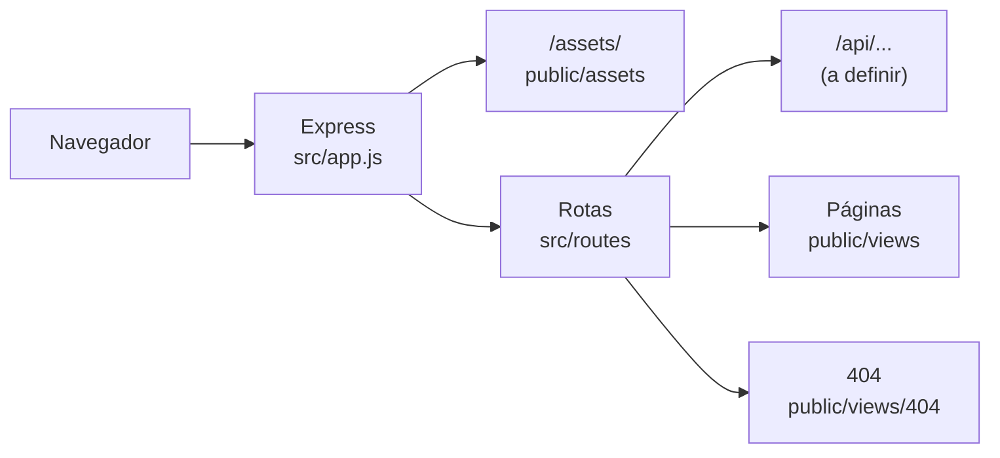

<!-- esqueleto de arquivo, ainda tem que definir com o a prof como será a entrega de dados -->
# Arquitetura

O Fibrosync é um site em HTML, CSS e JavaScript puro servido por um servidor Node.js com Express. a camada de dados (API, persistência e integrações) ainda está **A definir**.

## Fontes relacionadas

- [Projeto FIB no Jira](https://aluno-team-zylgcwkh.atlassian.net/jira/software/projects/FIB/summary)
- [Espaço do Fibrosync no Confluence](https://aluno-team-zylgcwkh.atlassian.net/wiki/spaces/F/overview)
- [Decisões de arquitetura](../decisions/overview.md)
- [Fluxo de desenvolvimento](../workflows/desenvolvimento.md)

## Contexto do sistema

<!-- Descrever os usuários, sistemas externos e responsabilidades do Fibrosync. -->

| Ator | Papel |
|---|---|
| Paciente | Usuário final: cadastra-se, faz login e acompanha a própria condição |
| Médico | A definir |
| Sistemas externos | A definir (ex.: serviço de clima) |

## Visão geral

<!-- Atualizar o diagrama quando os componentes e integrações forem definidos. -->

Ordem em que o servidor tenta atender uma requisição:

1. `/assets/...` → arquivos compartilhados em `public/assets`;
2. rotas de API (`/api/...`), quando existirem;
3. páginas: `/` redireciona para `/landing-page/`, e `/<pagina>/` entrega `public/views/<pagina>/`;
4. nada encontrado → página 404 (HTML) ou erro JSON (API);
5. qualquer exceção → tratador de erros, que responde `500`.

## Componentes

| Componente | Responsabilidade | Dependências |
|---|---|---|
| `public/views/<pagina>/` | Uma tela: `index.html`, `style.css` e `script.js` | `public/assets` |
| `public/assets/` | Imagens e `tokens.css` (design system) compartilhados | — |
| `src/server.js` | Inicia o servidor na porta configurada | `app.js`, `config/env.js` |
| `src/app.js` | Configura o Express: assets, rotas, 404 e erros | Express |
| `src/routes/index.js` | Junta os routers (API e páginas) | `pages.routes.js` |
| `src/routes/pages.routes.js` | Serve as pastas de `public/views` como páginas | `config/paths.js` |
| `src/middlewares/` | Resposta 404 e tratamento de erros | `config/` |
| `src/config/` | Variáveis de ambiente e caminhos das pastas | — |

Camadas previstas para a API, criadas conforme a necessidade: `controllers/`, `services/` e `repositories/` (ver [Fluxo de desenvolvimento](../workflows/desenvolvimento.md#7-adicionando-rotas-de-api)).

## Fluxo de dados

<!-- Registrar apenas os fluxos relevantes para compreender a arquitetura. -->

Ainda não há troca de dados com o servidor: os formulários de cadastro e login apenas navegam para a próxima página. O formato de envio e armazenamento será registrado aqui quando a API for definida.

## Integrações externas

| Integração | Finalidade | Referência |
|---|---|---|
| Google Fonts | Fontes Outfit e Inter, ícones Material Symbols | Carregadas diretamente pelas páginas |

## Restrições e requisitos arquiteturais

- Front-end em HTML, CSS e JavaScript puro, sem framework nem etapa de build.
- Caminhos nas páginas sempre relativos à pasta da página, para funcionar pelo servidor e abrindo o arquivo direto.
- Dependências gerenciadas com pnpm ([ADR 0002](../decisions/0002-pnpm-como-gerenciador-de-pacotes.md)).
- Node.js 22.9 ou superior.

## Decisões relacionadas

As decisões e suas ligações com Jira, Confluence, Figma e Pull Requests estão no [mapa de ADRs](../decisions/overview.md).
